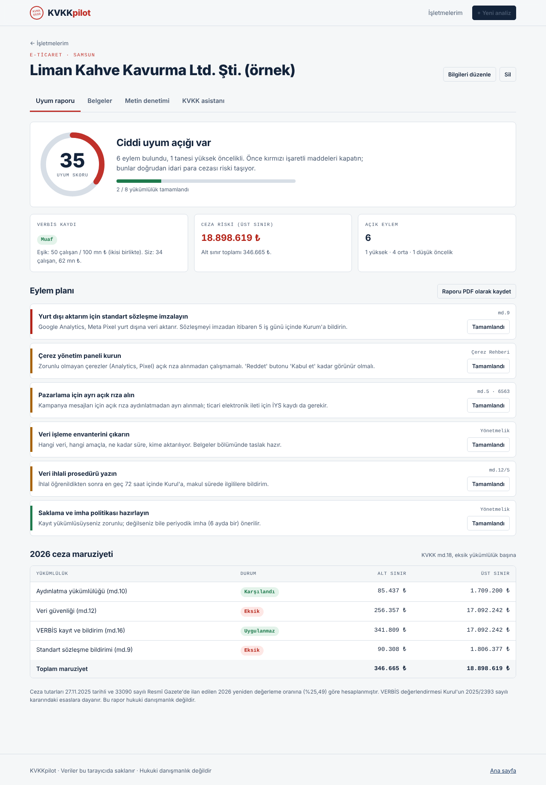

# KVKKpilot

**KOBİ'ler için yapay zekâ destekli KVKK uyum ajanı.** İşletmenizi anlatın; KVKKpilot uyum skorunuzu, VERBİS yükümlülüğünüzü ve 2026 ceza riskinizi hesaplasın, sektörünüze göre aydınlatma metni, çerez politikası ve veri envanterini hazırlasın.

🔗 **Canlı ürün:** https://kvkkpilot-blush.vercel.app
🎬 **Demo videosu:** [YouTube linki]



## Neden?

| | |
|---|---|
| **Problem** | Türkiye'de 3,93 milyon KOBİ kişisel veri işliyor (TÜİK, 2024). 2026'da tek bir KVKK ihlalinin idari para cezası 17,1 milyon ₺'ye kadar çıkıyor. Uyum işi bugün pahalı danışmanlarla ya da kopyala-yapıştır metinlerle yapılıyor. |
| **Neden şimdi** | Y Combinator Fall 2026 Requests for Startups listesinde **"AI-Native Compliance Infrastructure"** başlığı var. Kurul'un 2025/2393 sayılı kararı VERBİS eşiklerini netleştirdi, 7499 sayılı Kanun yurt dışı aktarımı standart sözleşmeye bağladı. |
| **Global referans (klon)** | Vanta, Drata, Termly: uyum skoru, kontrol listesi, politika üretici. Bunlar GDPR ve SOC 2 için tasarlandı. |
| **Yerelleştirme + yenilik** | KVKK, VERBİS hesabı, ₺ cinsinden 2026 cezaları, KVKK standart sözleşmesi, Türkçe sektörel belgeler; üstüne yapay zekâ ile belge iyileştirme, metin denetimi ve KVKK asistanı. |

## Özellikler

- **Uyum raporu:** 9 temel yükümlülük, işletmeye uygulanıp uygulanmadığına göre ağırlıklı skor; önem sırasına göre, madde atıflı eylem planı. "Tamamlandı" ile skor anında güncellenir.
- **VERBİS kontrolü:** Kurul 2025/2393 esasları (bilanço esasına göre defter tutanlarda çalışan + bilanço kriteri birlikte, tutmayanlarda yalnız çalışan sayısı; özel nitelikli veri işleyenlerde 10 çalışan / 10 mn ₺ eşiği).
- **2026 ceza riski:** KVKK md.18 tutarları, 33090 sayılı Resmî Gazete'deki %25,49 yeniden değerleme oranıyla.
- **5 hazır belge:** aydınlatma metni, çerez politikası, veri işleme envanteri, açık rıza metni, veri ihlali müdahale planı. Word (.doc) ve PDF çıktısı.
- **Metin denetimi:** Mevcut gizlilik metnini md.10'un 10 unsuruna göre puanlayan kural motoru + yapay zekâ yorumu.
- **KVKK asistanı:** İşletme profilini bilerek soruları yanıtlar.
- **Gizlilik:** İşletme bilgileri yalnızca kullanıcının tarayıcısında (localStorage) saklanır.

## Mimari

```
index.html          Tanıtım sayfası (VERBİS hızlı testi dahil)
app.html            Uygulama kabuğu
assets/engine.js    Kural motoru: mevzuat verisi, skor, VERBİS, ceza, belge üretici, metin denetimi
assets/app.js       Arayüz: pano, 5 adımlı sihirbaz, rapor, belgeler, denetim, asistan
assets/style.css    Tasarım sistemi (açık/koyu tema)
api/ai.js           Vercel sunucu fonksiyonu: Gemini / OpenAI / Anthropic
cypress/e2e/        Uçtan uca testler
demo/               Demo videosunu kaydeden betik (Playwright)
```

**Hibrit yaklaşım:** Kesin hesaplar (eşikler, cezalar, skor) deterministik kural motorunda; yazı ve yorum işleri yapay zekâda. Yapay zekâ anahtarı yoksa ürün yine tam çalışır, yalnızca yapay zekâ butonları gizlenir. Gemini'de bir model yoğunsa sunucu otomatik olarak sıradaki ücretsiz modeli dener.

Çerçeve veya derleme adımı yok: düz HTML, CSS ve JavaScript.

## Yerelde çalıştırma

```bash
git clone https://github.com/okanaliihsan/kvkkpilot.git
cd kvkkpilot
npm run dev          # http://localhost:3000
```

Yapay zekâ özellikleri için Vercel CLI ile çalıştırın ve `.env.example` dosyasını `.env` olarak kopyalayıp bir anahtar girin:

```bash
npx vercel dev
```

Ücretsiz Gemini anahtarı: https://aistudio.google.com

## Testler

```bash
npm install
npm run dev          # bir terminalde
npm run test:e2e     # diğerinde (Cypress, video kaydıyla)
```

## Yayınlama

Vercel'e içe aktarın; ortam değişkeni olarak `GEMINI_API_KEY` (veya `OPENAI_API_KEY` / `ANTHROPIC_API_KEY`) ekleyin. Derleme komutu gerekmez.

## Kaynaklar

- [Y Combinator Requests for Startups](https://www.ycombinator.com/rfs)
- [Kişisel Verileri Koruma Kurumu](https://www.kvkk.gov.tr)
- [2026 KVKK idari para cezaları](https://cottgroup.com/tr/mevzuat/item/yeniden-degerleme-oranina-gore-2026-yili-kvkk-idari-para-cezalari)
- [VERBİS kayıt istisnası uygulama esasları (Kurul 2025/2393)](https://cottgroup.com/tr/blog/kvkk-gdpr/item/verbise-kayit-yukumlulugu-istisnasina-iliskin-uygulama-esaslari-netlestirildi)

## Uyarı

Bu proje bir ders ödevi olarak geliştirilmiştir. KVKKpilot bir karar destek aracıdır, hukuki danışmanlık yerine geçmez.

## Lisans

MIT
